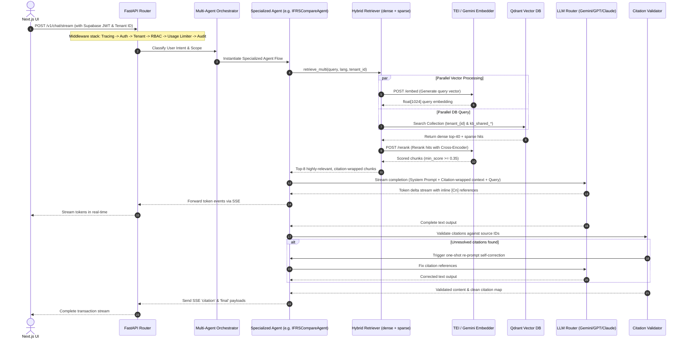
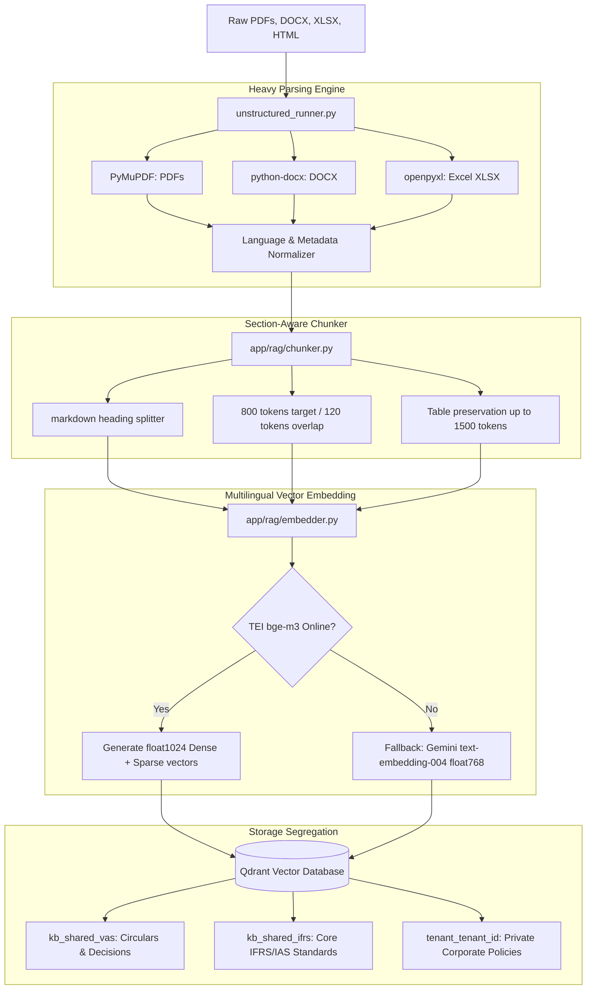

# VAS-IFRS Bridge (VIFB) 🌉
### Hybrid RAG & Financial Multi-Agent Translation Engine

[](https://github.com/23092003e/vas-ifrs-bridge/actions/workflows/ci-backend.yml)
[](https://github.com/23092003e/vas-ifrs-bridge/actions/workflows/ci-frontend.yml)
[](LICENSE)
[](apps/backend/)
[](apps/frontend/)

An enterprise-grade, high-security, multi-tenant platform designed to bridge the gap between **Vietnamese Accounting Standards (VAS)** and **International Financial Reporting Standards (IFRS)**. 

The platform utilizes a state-of-the-art hybrid RAG pipeline coupled with a cooperative financial multi-agent orchestrator. It automates General Ledger (GL) transformations, standard-by-standard comparative analysis, and double-entry adjustment generation while enforcing mathematical debit/credit balancing, absolute tenant data isolation, and legal citation grounding.

---

## 📖 Table of Contents
- [Core Technical Pillars](#-core-technical-pillars)
- [System Architecture](#%EF%B8%8F-system-architecture)
  - [1. Real-time Multi-Agent Request Flow](#1-real-time-multi-agent-request-flow)
  - [2. Offline Document Ingestion Pipeline](#2-offline-document-ingestion-pipeline)
- [Monorepo Directory Layout](#-monorepo-directory-layout)
- [Getting Started Runbook](#-getting-started-runbook)
  - [Prerequisites](#prerequisites)
  - [Step 1: Core Infrastructure Services](#step-1-core-infrastructure-services)
  - [Step 2: Backend Setup & DB Migrations](#step-2-backend-setup--db-migrations)
  - [Step 3: Ingesting Regulatory Knowledge Bases](#step-3-ingesting-regulatory-knowledge-bases)
  - [Step 4: Frontend Application Setup](#step-4-frontend-application-setup)
- [The Cooperative Multi-Agent Framework](#-the-cooperative-multi-agent-framework)
- [Stateful API Contracts](#-stateful-api-contracts)
- [Database & Multi-Tenant Isolation](#-database--multi-tenant-isolation)
  - [1. PostgreSQL Row-Level Security (RLS)](#1-postgresql-row-level-security-rls)
  - [2. Tenant Vector Space Partitioning](#2-tenant-vector-space-partitioning)
- [Testing & Quality Verification](#-testing--quality-verification)
- [DevOps & Production Infrastructure](#-devops--production-infrastructure)
- [Phase Roadmap](#-phase-roadmap)
- [License & Contributions](#-license--contributing)

---

## 💎 Core Technical Pillars

### 1. Advanced Hybrid RAG Engine
*   **Dense + Sparse Hybrid Search:** Searches over public regulatory standards and private tenant documents using **BAAI/bge-m3** (1024-dimension multilingual dense vectors) combined with Qdrant's sparse vector search for high-fidelity keyword matching.
*   **Cross-Encoder Reranking:** Filters and boosts retrieved chunks via **BAAI/bge-reranker-v2-m3** served through a high-throughput **Text-Embeddings-Inference (TEI)** gateway. It implements dynamic thresholding (`min_score=0.35`) and auto-relaxes under low-recall scenarios.
*   **Dual-Cloud Ingestion:** Native fallback to Google Gemini `text-embedding-004` (768-dimension) if self-hosted TEI services are offline, preventing ingestion bottlenecks.

### 2. Cooperative Financial Multi-Agent Orchestrator
*   **Intelligent Intent Classifier:** Analyzes incoming user requests and dynamically dispatches sub-tasks to specialized agents (`RetrievalAgent`, `IFRSCompareAgent`, `GLMappingAgent`, `AdjustmentAgent`, and `ReportAgent`) via concurrent `asyncio.TaskGroup` flows.
*   **Self-Correcting Citation Validator:** Enforces inline citation keys (`[Cn]`) mapped directly to legislative document IDs. If the LLM generates unsupported assertions, the validator triggers an automated one-shot correction prompt to eliminate hallucination, stripping unresolved references as a fallback.
*   **Prompt Registry & Assembly:** Prompts are organized in a centralized system registry (`prompts/registry.yaml`) and compiled on-the-fly using Jinja2 templates, incorporating real-time tenant context, user language preferences, and safety rules.

### 3. IFRS Adjustment & GL Mapping Engine
*   **RAG-Grounded COA Mapping:** Automatically translates a client's General Ledger (GL) Chart of Accounts (COA) from VAS codes to IFRS classifications, providing explicit rationales and compliance citations for every proposed mapping.
*   **Balanced Double-Entry Generator:** Synthesizes adjusting journal entries to restate VAS balances to IFRS compliance (e.g., capitalizing operating leases under IFRS 16 or provisioning expected credit losses under IFRS 9).
*   **Mathematical Balance Guard:** Implements a deterministic parser that extracts adjustment rows and strictly verifies that $\sum \text{Debits} = \sum \text{Credits}$ to the penny. It raises `UnbalancedJE` exceptions and rejects unbalanced drafts before they reach the ledger.

### 4. Next.js 14 Premium User Interface
*   **Dynamic Chat Stream:** Features a low-latency Server-Sent Events (SSE) stream returning markdown text, inline mathematical equations, progress markers, and interactive citation cards side-by-side.
*   **Comparative Diff Viewer:** Interactive side-by-side code/text parallel view showcasing legal differences between Vietnamese Accounting Standards and corresponding IFRS texts.
*   **GL Workspace:** Full-featured drag-and-drop file upload zone, account mapping workspace with interactive validation tables, and a journal entry auditor approval dashboard.

---

## 🗺️ System Architecture

### 1. Real-time Multi-Agent Request Flow

This diagram illustrates the flow of a user query through the backend middleware, agent orchestration, hybrid retrieval, and final citation verification:



### 2. Offline Document Ingestion Pipeline

Heavy PDF/XLSX legal documents, decrees, and tenant manuals are parsed, chunked, embedded, and indexed offline or asynchronously:



---

## 📂 Monorepo Directory Layout

The workspace is organized as a pnpm-managed monorepo for JS/TS packages and python virtual environments for the core FastAPI service:

```
vas-ifrs-bridge/
├── apps/
│   ├── frontend/                         # Next.js 14 Web Application
│   │   ├── src/
│   │   │   ├── app/                      # App Router (auth, compare, chat, GL workspaces)
│   │   │   ├── components/               # UI components (ChatStream, MappingTable, diffs)
│   │   │   ├── lib/                      # Supabase client, API clients, i18n localization
│   │   │   └── types/                    # Shared TypeScript types
│   │   └── package.json
│   │
│   └── backend/                          # FastAPI Service (Python 3.11/3.12)
│       ├── app/
│       │   ├── api/v1/                   # Router mounts (chat, kb, mappings, adjustments)
│       │   ├── agents/                   # Multi-agent registry (Orchestrator, GL, Adjustment)
│       │   ├── tools/                    # Tool definitions (search_kb, parse_gl, map_account)
│       │   ├── rag/                      # Dense-sparse hybrid search & rerank pipelines
│       │   ├── llm/                      # Cost-latency router & model providers
│       │   ├── core/                     # JWT auth, tenant resolvers, RBAC table, audit logger
│       │   ├── db/                       # SQLAlchemy async PostgreSQL models & repos
│       │   ├── gl/                       # Ledger analysis & double-entry balance engines
│       │   ├── prompts/                  # Jinja2 template definitions and registries
│       │   └── observability/            # OpenTelemetry tracing & structlog configs
│       ├── alembic/                      # SQL Database migration versions
│       ├── tests/                        # unit, integration, and e2e test suites
│       └── pyproject.toml
│
├── ingestion/                            # Standalone document processing pipelines
│   ├── pipelines/                        # VAS circulars & IFRS standards parser rules
│   └── batch_embed.py                    # Heavy document parsing, embedding & indexing script
│
├── orchestration/
│   └── n8n/                              # Asynchronous workflow configurations
│       └── workflows/                    # Document ingest, GL background parsing & reports pipelines
│
├── infra/                                # Deployment configurations
│   ├── terraform/                        # Infrastructure-as-code (VPC, GKE, GCS, Secret Manager)
│   ├── k8s/                              # Kubernetes manifests (deployments, ingresses, network policies)
│   └── docker/                           # Local docker compose configurations (Qdrant, Redis, Ollama)
│
├── prompts/                              # Centrally-versioned prompt registry
├── supabase/                             # Postgres initial migrations & edge functions
├── mcp/                                  # Model Context Protocol servers for development
└── Makefile                              # Top-level orchestrator command targets
```

---

## 🚀 Getting Started Runbook

Follow these instructions to configure and run the full stack locally for development and testing.

### Prerequisites
*   **Operating System:** macOS (Apple Silicon recommended) or Linux.
*   **Package Managers:** Python 3.11+, [uv](https://github.com/astral-sh/uv) (recommended) or `pip`, Node.js 18+, and [pnpm](https://pnpm.io/).
*   **Docker:** Installed and running locally.
*   **Cloud Keys:** Google Gemini API Key (required), OpenAI/Anthropic API Keys (optional).

---

### Step 1: Core Infrastructure Services
Boot up the vector database, caching layers, and local models via Docker Compose:

```bash
# Clone the repository
git clone https://github.com/23092003e/vas-ifrs-bridge.git
cd vas-ifrs-bridge

# Spin up Qdrant Vector DB, Redis, and local Ollama
docker compose -f infra/docker/docker-compose.dev.yml up -d
```

---

### Step 2: Backend Setup & DB Migrations
The backend uses Python 3.11/3.12 with FastAPI. We recommend using `uv` for lightning-fast virtual environment management.

1. **Navigate to the backend directory & create virtual environment:**
```bash
cd apps/backend
uv venv .venv
source .venv/bin/activate
```

2. **Install dependencies in editable development mode:**
```bash
uv pip install -e ".[dev]"
```

3. **Configure Environment Variables:**
Copy the `.env.example` to `.env` and fill in your cloud providers and databases:
```bash
cp .env.example .env
```
Ensure you provide your `GEMINI_API_KEY`, `SUPABASE_URL`, `SUPABASE_SERVICE_ROLE_KEY`, and set `DEV_AUTH_BYPASS=true` to simplify local API testing without a JWT gateway.

4. **Run SQL Database Migrations:**
Initialize your database schemas via Alembic:
```bash
alembic upgrade head
```

5. **Start the FastAPI Development Server:**
```bash
uvicorn app.main:app --reload --port 8000
```
The server will boot on [http://localhost:8000](http://localhost:8000). You can inspect the interactive OpenAPI documentation at [http://localhost:8000/docs](http://localhost:8000/docs).

---

### Step 3: Ingesting Regulatory Knowledge Bases
Before executing chat or mapping pipelines, you need to populate the shared regulatory knowledge bases (Circulars & Standards) in Qdrant.

1. **Place raw legal files** in `ingestion/raw/shared/vas` (PDF/Word circulars) and `ingestion/raw/shared/ifrs` (IAS/IFRS documents).
2. **Execute the ingestion runner script:**
```bash
# From the repository root, run the multi-scope ingest pipeline
# If on macOS / Linux, run via python directly:
python ingestion/batch_embed.py --scope shared
```
*(On Windows systems, you can alternatively execute `./ingest.ps1` in PowerShell).*

This parses standard sections, structures markdown headings, chunks to 800 tokens, embeds using `BAAI/bge-m3` (falling back to Gemini if offline), and indexes into the `kb_shared_vas` and `kb_shared_ifrs` collections inside Qdrant.

---

### Step 4: Frontend Application Setup
The frontend is a premium Next.js 14 application styled using Tailwind CSS and shadcn UI.

1. **Navigate to the frontend directory:**
```bash
cd ../../apps/frontend
```

2. **Install workspace dependencies:**
```bash
pnpm install
```

3. **Configure Frontend Environment:**
Copy `.env.local.example` to `.env.local` and define the backend port:
```bash
cp .env.local.example .env.local
```
Configure `BACKEND_URL=http://localhost:8000` and your local Supabase credentials.

4. **Launch the Hot-Reloading Development Server:**
```bash
pnpm dev
```
Open [http://localhost:3000](http://localhost:3000) in your browser to interact with the application.

---

## 🤖 The Cooperative Multi-Agent Framework

VIFB leverages a set of specialized agents inheriting from `AgentBase` which are dynamically coordinated by `Orchestrator`:

```
                           [ User Query ]
                                  │
                                  ▼
                     [ Multi-Agent Orchestrator ]
                     (Intent & Routing Classifier)
                                  │
        ┌────────────────┬────────┴───────┬────────────────┐
        ▼                ▼                ▼                ▼
[ RetrievalAgent ] [ IFRSCompareAgent ] [ GLMappingAgent ] [ AdjustmentAgent ]
  Semantic RAG     Side-by-side Diff    RAG COA Matcher    Balanced Double
  QA engine        Standard Viewer      and Linker         Entry JE Generator
        │                │                │                │
        └────────────────┼────────────────┴────────────────┘
                         ▼
             [ Citation Validator Agent ]
          (Grounding Verification & Cleanup)
                         │
                         ▼
                [ SSE Stream Response ]
```

### 📋 Agent Roster & Behavior Contracts

1.  **`RetrievalAgent`**
    *   **Focus:** Answers general legal-accounting questions grounded exclusively in the context.
    *   **Strategy:** Dual-scope queries querying both Public and Tenant collections. Falls back to BM25 in vector network failure.
2.  **`IFRSCompareAgent`**
    *   **Focus:** Structured parallel evaluation of standard discrepancies.
    *   **Strategy:** Explores overlap mappings (e.g., VAS 15 vs. IFRS 15), formatting outputs in structured aspects: "Recognition", "Measurement", and "Disclosure".
3.  **`GLMappingAgent`**
    *   **Focus:** Aligns general ledger accounts with standard frameworks.
    *   **Strategy:** Evaluates incoming client accounts, queries historical mapping vectors, and outputs a confidence score with reasoning. Rows below `0.70` confidence are marked `requires_review=true`.
4.  **`AdjustmentAgent`**
    *   **Focus:** Restructures balances by synthesizing compliant adjusting entries.
    *   **Strategy:** Analyzes differences and outputs detailed journal entries. Downstream parsers strictly enforce and validate that Debit/Credit totals match before drafting.
5.  **`CitationValidator`**
    *   **Focus:** Guardrail agent running on post-completion hooks.
    *   **Strategy:** Extracts inline cite tags, verifies integrity against retrieval payloads, and triggers self-correction loops on failure.

---

## 🔌 State-of-the-Art API Contracts

Below are core, stateful API payloads designed for high-concurrency client-server interaction:

### 1. Real-time Chat SSE Stream
*   **Path:** `POST /v1/chat/stream`
*   **Payload:**
```json
{
  "conversation_id": "8f370e7e-3759-47fe-bbba-c3be27918a2d",
  "content": "Hãy so sánh cách ghi nhận doanh thu dịch vụ giữa Thông tư 200 (VAS 15) và IFRS 15.",
  "intent_hint": "compare",
  "reasoning": "balanced",
  "scope": "shared",
  "lang": "vi"
}
```
*   **Stream Events Output:**
```sse
data: {"type": "intent", "intent": "compare"}

data: {"type": "token", "delta": "### So sánh Doanh thu dịch vụ\n\nTheo quy định của **VAS 15** [C1], doanh thu..."}

data: {"type": "citation", "key": "C1", "doc_id": "vas-circular-200", "chunk_id": "chk-9921", "standard_code": "VAS-15", "snippet": "Doanh thu cung cấp dịch vụ được ghi nhận khi xác định được kết quả giao dịch..."}

data: {"type": "final", "content": "..."}
```

### 2. Balanced Adjustments Generator
*   **Path:** `POST /v1/gl/adjustments`
*   **Payload:**
```json
{
  "upload_id": "bfd80d28-7681-420a-8bfb-92736181bf48",
  "period": "2026-12-31",
  "mapping_results": [
    {
      "src_account_code": "6422",
      "src_account_name": "Chi phí thuê văn phòng (VAS)",
      "target_standard": "IFRS",
      "target_account_code": "ROU_ASSET",
      "target_account_name": "IFRS Right-of-Use Asset",
      "confidence": 0.95,
      "rationale": "Trực thuộc hợp đồng thuê tài sản dài hạn quy định bởi IFRS 16"
    }
  ]
}
```
*   **Response (Validated & Balanced Journal Entries):**
```json
{
  "status": "success",
  "balanced": true,
  "entries": [
    {
      "entry_id": "ADJ-001",
      "debit_account": "IFRS Right-of-Use Asset",
      "credit_account": "IFRS Lease Liability",
      "amount": 150000.0,
      "rationale": "Capitalise operating lease under IFRS 16 guidelines.",
      "standard": "IFRS 16"
    }
  ]
}
```

---

## 🔒 Database & Multi-Tenant Isolation

Corporate audit data, client transaction ledgers, and operational trial balances are protected under absolute hardware and database boundaries.

### 1. PostgreSQL Row-Level Security (RLS)
The database enforces strict tenant isolation at the SQL level. Any database user query must route through policies reading the tenant claim natively stored within the caller's JWT:

```sql
-- Enable Row-Level Security on core transaction ledger
ALTER TABLE documents ENABLE ROW LEVEL SECURITY;

-- Dynamic isolation query verified by Postgres Engine
CREATE POLICY doc_tenant_isolation_policy ON documents
  FOR ALL
  USING (
    scope = 'shared' 
    OR tenant_id = (auth.jwt() ->> 'tenant_id')::uuid
  )
  WITH CHECK (
    tenant_id = (auth.jwt() ->> 'tenant_id')::uuid
  );
```

### 2. Tenant Vector Space Partitioning
*   **Public Knowledge Base Collection:** Pre-indexed regulatory documents (`kb_shared_vas`, `kb_shared_ifrs`) are shared read-only collections.
*   **Isolated Private Tenant Space:** When a new enterprise client onboarding process completes, an edge trigger deploys a dedicated collection: `tenant_{tenant_id}`.
*   **Vector Search Scope Enforcement:** Every programmatic search query executes with explicit, system-level filters, preventing token leaks across enterprise accounts:
```python
# Secured runtime filter context inside retriever.py
tenant_filter = Filter(
    must=[
        FieldCondition(key="tenant_id", match=MatchValue(value=tenant_id))
    ]
)
```

---

## 🧪 Testing & Quality Verification

VIFB maintains high code standards through strict type checking, comprehensive unit tests, and continuous evaluation of RAG retrieval quality.

```bash
# Run backend tests
cd apps/backend
pytest tests/unit/ -v

# Run linting checks (Ruff)
ruff check .

# Run static type checks (Mypy)
mypy app/
```

Our testing suites comprehensively cover crucial paths:
*   **Balanced debit/credit math checks** to verify unbalanced mappings throw `UnbalancedJE` exceptions and fail safely.
*   **Import validity across components** preventing runtime orchestration blocks.
*   **Mypy strict compliance** to avoid runtime dynamic typing errors.

### RAG Retrieval and Hallucination Evaluation Suite
To safeguard regulatory accuracy, nightly pipelines run evaluations against validation datasets located in `apps/backend/app/eval/datasets/`:
```bash
# Evaluate retrieval quality (Recall@K, MRR, Precision@K)
python -m app.eval.retrieval_eval --dataset app/eval/datasets/vas_qa_vi.jsonl --k 10

# Evaluate hallucination metrics (Faithfulness, Answer Relevancy, Context Precision)
python -m app.eval.hallucination_eval --dataset app/eval/datasets/hallucination_test.jsonl
```
*   **Retaining Recall Quality:** The system targets $\text{Recall@10} \ge 0.85$ and $\text{Faithfulness} \ge 0.85$ (LLM-as-a-judge faith scoring) to meet audit standards.

---

## ☸️ DevOps & Production Infrastructure

Enterprise deployments utilize infrastructure-as-code and orchestrated cloud Kubernetes clustering:

```
[ Git Commits ] ──► [ GitHub Actions CI ] ──► [ Artifact Registry ]
                                                    │
                                                    ▼
[ GCP KMS / Secrets ] ◄── [ Helm Upgrades ] ──► [ GKE Cluster ]
                                                    │
                             ┌──────────────────────┼──────────────────────┐
                             ▼                      ▼                      ▼
                     [ Next.js Pods ]       [ FastAPI Pods ]       [ Qdrant Stateful ]
```

*   **Terraform Provisioning (`infra/terraform/`):** Manages VPC networks, secure Google Cloud Storage (GCS) buckets (isolated per tenant, with cold-tier audit archival policies), Google Kubernetes Engine (GKE) clusters with dedicated Nvidia GPU node pools for self-hosted local model execution.
*   **Kubernetes Manifests (`infra/k8s/`):** Implements fine-grained network policies restricting pod communications, ingress rules configuring automated TLS certificates, and resource-bounded configurations for background Celery workers utilizing Redis.
*   **Asynchronous Orchestration (`orchestration/n8n/`):** Coordinates asynchronous webhooks on file ingestion, processing Excel files via celery tasks, and distributing progress notifications to client browsers in real-time.

---

## 📅 Phase Roadmap

| Phase | Milestone | Focus Capabilities | Acceptance Standards |
|:---:|---|---|---|
| **Phase 1** | **Core MVP RAG** | Ingest regulatory texts, Stream SSE response, Parallel Diff compare panel | $P_{95} \text{ latency} < 8s$<br>$\text{Recall@10} \ge 0.85$<br>$100\% \text{ citations validated}$ |
| **Phase 2** | **GL Transformation** | Excel/CSV GL parsers, AI-assisted account mapping, Double-entry balanced generator | $\text{Processing } 100k \text{ rows} < 60s$<br>$\text{COA Mapping accuracy} \ge 92\%$<br>$\text{Debit = Credit strictly enforced}$ |
| **Phase 3** | **Enterprise Ready** | Financial reports synthesis, Excel/PDF signed exports, Full audit trails | $100\% \text{ audit logging for mutations}$<br>$\text{PII data redaction in exports}$<br>$\text{Instant admin role revocation}$ |

---

## 📄 License & Contributing

Licensed under the [MIT License](LICENSE). 

We welcome contributions from financial engineers, regulatory SMEs, and software professionals. Please submit issue tickets or open draft Pull Requests against dev branches. Ensure all commits comply with local static checks, ruff rules, and pass standard unit test assertions.

---

Developed with absolute precision to power the future of automated financial compliance. 🚀