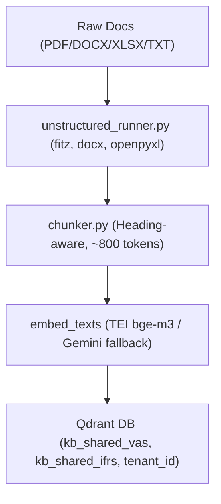
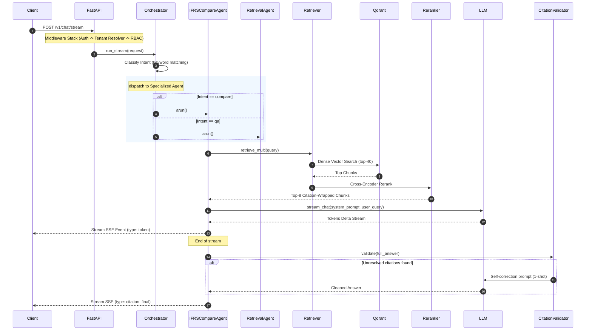
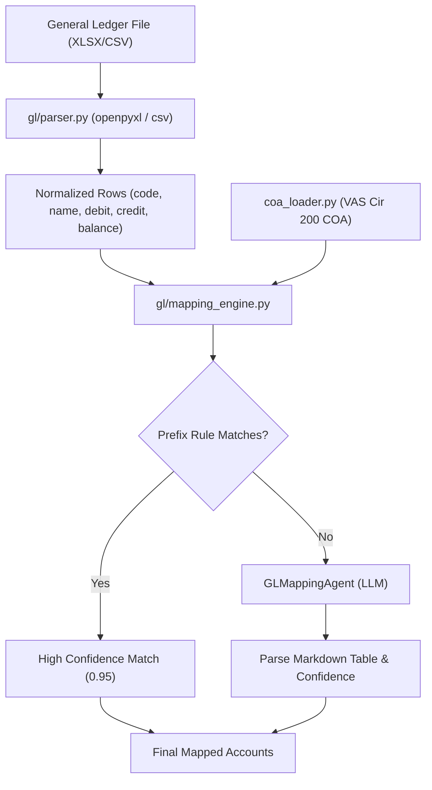

# Hệ thống Đối chiếu VAS-IFRS (VIFB) — Tài liệu Kiến trúc & Workflows

Dự án **VAS-IFRS Bridge (VIFB)** là một hệ thống Multi-Agent kết hợp với luồng Hybrid RAG tiên tiến giúp tra cứu quy định kế toán, đối chiếu chuẩn mực (VAS ↔ IFRS) và tự động hóa chuyển đổi Bảng cân đối tài khoản (GL Chart of Accounts) từ VAS sang IFRS.

Dưới đây là chi tiết về cấu trúc hệ thống và luồng công việc (workflows) đang hoạt động trong dự án.

---

## 1. Bản đồ Kiến trúc Tổng quan (System Overview)

Hệ thống được tổ chức dưới dạng monorepo chia làm 2 phân hệ chính kết nối qua REST API và SSE (Server-Sent Events):

```
                        +----------------------------+
                        |     Next.js Frontend       |
                        |      (Cổng :3000)          |
                        +--------------+-------------+
                                       |
                     (SSE Proxy /api/chat/stream)
                                       v
                        +----------------------------+
                        |      FastAPI Backend       |
                        |      (Cổng :8000)          |
                        +---+----+----+----+----+----+
                            |    |    |    |    |
       +--------------------+    |    |    |    +-------------------+
       |                         |    |    |                        |
       v                         v    v    v                        v
+--------------+    +------------+-------+-----------+      +---------------+
| PostgreSQL   |    | Vector DB  | Embedder  | Reranker  |      | Google Gemini |
| (Supabase)   |    | (Qdrant)   | (bge-m3 / | (bge-     |      |  (Primary     |
| RLS Enabled  |    | Port :6333 | Gemini)   | reranker) |      |   LLM Engine) |
+--------------+    +------------+-----------+-----------+      +---------------+
```

---

## 2. Các Luồng Công Việc Chi Tiết (Workflows)

### Workflow 1: Nạp và nhúng dữ liệu tri thức (Document Ingestion Pipeline)
Luồng này đảm nhiệm việc phân tích các tài liệu chuẩn mực kế toán thô (PDF, Word, Excel) thành các vectors lưu trữ trong Qdrant.



1.  **Trích xuất (Parsing)**: File thô trong `ingestion/raw/` được phân tích dựa trên phần mở rộng file (PDF dùng `pymupdf/fitz`, DOCX dùng `python-docx`, XLSX dùng `openpyxl`). Kết quả là văn bản thô kèm ngôn ngữ (`vi` hoặc `en`) và mã chuẩn mực (`standard_code`).
2.  **Chia nhỏ (Chunking)**: Hàm `chunk_document` phân rã văn bản dựa trên các thẻ headings của Markdown, hướng tới độ dài 800 tokens mỗi đoạn, đè chồng (overlap) 120 tokens để giữ ngữ cảnh liền mạch.
3.  **Nhúng vector (Embedding)**: Chunks được mã hóa thành các vectors 1024 chiều bằng mô hình `bge-m3` chạy trên TEI (Text Embeddings Inference). Nếu TEI offline, hệ thống tự động fallback sang Google Gemini `gemini-embedding-001` (vector 3072 chiều).
4.  **Lưu trữ (Qdrant Storage)**: Vectors được nạp vào Qdrant và đánh chỉ mục payload để phục vụ lọc nhanh theo `tenant_id`, `lang`, `standard_code`, v.v.

---

### Workflow 2: Trò chuyện và Đối chiếu Chuẩn mực (SSE RAG Chat Workflow)
Xử lý các câu hỏi tra cứu hoặc yêu cầu so sánh song song giữa chuẩn kế toán Việt Nam (VAS) và chuẩn báo cáo tài chính quốc tế (IFRS).



1.  **Phân loại ý định**: `Orchestrator` nhận câu hỏi, thực hiện phân tích từ khóa thô để gán nhãn `compare` (so sánh), `mapping` (ánh xạ), hoặc `qa` (hỏi đáp chung).
2.  **Truy xuất Hybrid**: Agent gọi `retrieve_multi()` để tìm kiếm đồng thời trên kho dữ liệu dùng chung (VAS/IFRS) và kho dữ liệu riêng của tenant.
3.  **Xếp hạng lại (Rerank)**: Sử dụng Cross-Encoder của TEI để chấm điểm lại mức độ khớp của các đoạn văn bản thô, chọn ra 8 đoạn có điểm cao nhất (ngưỡng tối thiểu `0.35`).
4.  **Đính kèm trích dẫn (Citations)**: Gói các đoạn văn bản trong các thẻ `<<C{n} src="..." >>` và yêu cầu LLM bắt buộc ghi chú `[Cn]` trong câu trả lời nếu dùng dữ liệu đó.
5.  **Hậu kiểm tra (Post-validation)**: `CitationValidator` kiểm tra xem tất cả các thẻ `[Cn]` trong kết quả LLM có thực sự nằm trong danh sách tài liệu tham chiếu không. Nếu có thẻ "ma" do LLM tự bịa, hệ thống tự động kích hoạt prompt yêu cầu sửa đổi nhanh trước khi kết thúc luồng.

---

### Workflow 3: Chuyển đổi và Ánh xạ Sổ cái (GL Transformation Workflow)
Luồng nghiệp vụ xử lý bảng cân đối phát sinh tài khoản của doanh nghiệp, ánh xạ từ mã tài khoản VAS sang mã tài khoản IFRS tương đương.



1.  **Phân tích & Chuẩn hóa**: File Excel kế toán được tải lên thông qua `gl/parser.py`. Hàm `parse()` tự động tìm dòng chứa tiêu đề cột và lọc ra các dòng tài khoản hợp lệ, chuẩn hóa số dư Nợ/Có.
2.  **Ánh xạ bằng Luật cứng**: Sử dụng `coa_loader.py` chứa bảng danh mục chuẩn của Thông tư 200. Các tài khoản có mã khớp trực tiếp hoặc khớp theo tiền tố (Ví dụ: `1111` khớp với `111` - Tiền mặt) được gán kết quả ngay lập tức với mức tin cậy `0.95`.
3.  **Dự phòng bằng AI (LLM Fallback)**: Các tài khoản chi tiết tự tạo của doanh nghiệp không khớp luật được gom lại thành lô và gửi đến `GLMappingAgent`. Agent sẽ sử dụng RAG để tìm định nghĩa tương đương trên IFRS và trả về bảng gợi ý.
4.  **Kết quả đầu ra**: Danh sách ánh xạ hoàn chỉnh hiển thị lên giao diện UI cho kế toán kiểm tra và phê duyệt.

---

### Workflow 4: Tạo bút toán điều chỉnh kế toán (Adjustments Generation)
Tạo ra các bút toán ghi sổ kép Nợ/Có giúp điều chỉnh báo cáo tài chính từ chuẩn mực VAS sang IFRS.

1.  **Nhận diện chênh lệch**: Người dùng chọn các tài khoản có chênh lệch lớn sau bước ánh xạ (Ví dụ: Chi phí trả trước văn phòng theo IFRS 16 cần vốn hóa thành Tài sản Quyền sử dụng đất ROU).
2.  **Sinh bút toán**: `AdjustmentAgent` nhận danh sách ánh xạ, viết prompt mô tả nghiệp vụ và gọi LLM sinh ra bút toán kép chi tiết dưới dạng bảng markdown và khối dữ liệu cấu trúc JSON.
3.  **Kiểm tra tính cân đối kế toán**: Hàm `generate_entries()` bóc tách phần JSON từ câu trả lời của LLM, sau đó kiểm tra nghiêm ngặt xem:
    $$\sum \text{Nợ (Debits)} = \sum \text{Có (Credits)}$$
    Nếu có bất kỳ sai lệch nào dù chỉ 1 đồng, hệ thống sẽ từ chối lưu và ném ra lỗi `UnbalancedJE`.
4.  **Phê duyệt**: Bút toán cân đối được lưu ở trạng thái `draft` trong PostgreSQL cho đến khi được kế toán trưởng phê duyệt (`approved`).

---

## 3. Bản đồ Mã nguồn & Điểm phân phối nhiệm vụ (Code Registry Map)

*   **Bộ lọc Middleware**: [main.py](file:///Users/manh-greydigi/vas-ifrs-bridge/apps/backend/app/main.py)
*   **Thực thể Dữ liệu**: [models/__init__.py](file:///Users/manh-greydigi/vas-ifrs-bridge/apps/backend/app/db/models/__init__.py)
*   **Trình xử lý Sổ cái**:
    *   [parser.py](file:///Users/manh-greydigi/vas-ifrs-bridge/apps/backend/app/gl/parser.py) (Đọc file Excel/CSV)
    *   [coa_loader.py](file:///Users/manh-greydigi/vas-ifrs-bridge/apps/backend/app/gl/coa_loader.py) (Danh mục tài khoản VAS)
    *   [mapping_engine.py](file:///Users/manh-greydigi/vas-ifrs-bridge/apps/backend/app/gl/mapping_engine.py) (Bộ máy đối chiếu và fallback LLM)
    *   [adjustments.py](file:///Users/manh-greydigi/vas-ifrs-bridge/apps/backend/app/gl/adjustments.py) (Tạo bút toán & Kiểm tra cân bằng kế toán)
*   **Tác vụ chạy nền (Celery)**: `apps/backend/app/workers/`
